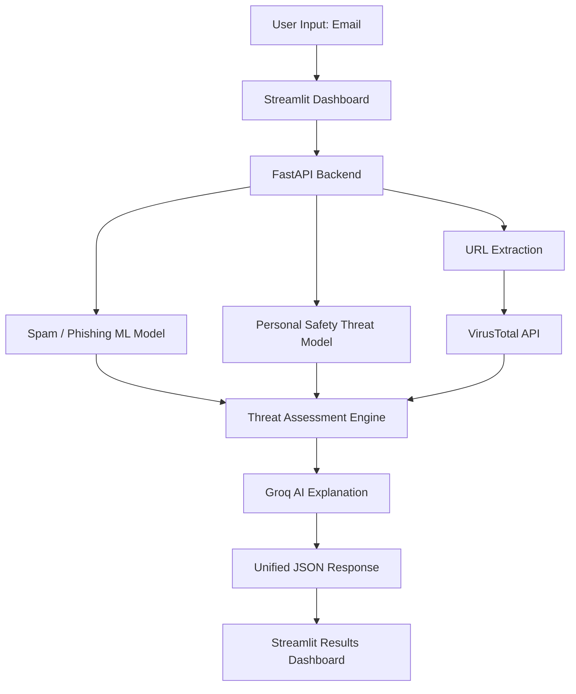

# 🛡️ Sentinel AI — Intelligent Email Threat Detection System

<p align="center">
  <strong>An AI-powered email security and threat intelligence platform</strong>
  <br>
  Detect spam, phishing, malicious URLs, and personal safety threats using Machine Learning, NLP, external threat intelligence, and LLM-powered explanations.
</p>

<p align="center">
  
  
  
  
  
  
</p>

---

## 📌 Overview

**Sentinel AI** is an intelligent email threat detection and analysis platform designed to identify potentially harmful email communications through multiple layers of security analysis.

Traditional spam filters primarily focus on determining whether an email is spam or legitimate. However, modern email-based threats extend beyond conventional spam, including phishing attempts, malicious URLs, intimidation, blackmail, stalking, and threats of physical violence.

Sentinel AI addresses this broader security problem by integrating multiple machine learning models, URL reputation intelligence, and large language model-based explanations into a unified analysis pipeline.

The system analyzes email content, evaluates potential risks, and generates understandable threat assessments.

Rather than relying on a single classifier, Sentinel AI combines different detection mechanisms to provide a more comprehensive view of email security.

## ✨ Key Features

### 1. Spam and Phishing Detection

Uses a trained machine learning pipeline to classify incoming email content into:

- **Spam / Phishing:** Potentially unwanted, deceptive, or malicious email.
- **Legitimate:** Email classified as non-spam by the trained model.

The spam detection pipeline incorporates custom NLP and feature engineering components.

It also provides a model confidence score when probability estimates are available.

### 2. Personal Safety Threat Detection

One of the distinguishing components of Sentinel AI is its personal safety threat classification system.

It identifies four categories of potentially harmful communication:

| Threat Category | Description |
|---|---|
| Physical Violence | Detects language indicating possible physical harm or violence. |
| Death Threat | Identifies communication containing potential threats to someone's life. |
| Blackmail / Extortion | Detects attempts to intimidate or coerce individuals. |
| Stalking | Identifies potentially threatening or harassing communication. |

The system evaluates these categories independently, allowing multiple threat labels to be identified in a single email.

### 3. URL Extraction and Reputation Analysis

Emails frequently contain suspicious links designed to redirect users toward malicious websites, phishing pages, or other potentially harmful destinations.

Sentinel AI automatically extracts URLs from:

- Email body text.
- Email subject lines.
- Markdown-formatted links.
- Standard HTTP and HTTPS links.
- URLs beginning with `www`.

Extracted URLs are checked against the VirusTotal URL reputation API.

Possible reputation results include:

| Status | Meaning |
|---|---|
| Malicious | VirusTotal reports malicious detections. |
| Suspicious | Suspicious detections are reported. |
| No malicious detections | The available report contains no malicious or suspicious detections. |
| No report | No existing reputation report is available. |
| Lookup error | The reputation lookup could not be completed. |

The system also retrieves available malicious, suspicious, harmless, and undetected detection counts.

### 4. AI-Powered Threat Explanation

Sentinel AI integrates the Groq API to generate natural-language explanations of analysis results.

Instead of displaying only machine learning predictions, the system provides contextual explanations based on:

- Spam and phishing classification.
- Model confidence when available.
- Personal safety threat predictions.
- URL reputation results.

This makes the results easier to understand and interpret.

If the Groq explanation service is unavailable, the backend returns a fallback message instead of failing the entire analysis.

### 5. Unified Threat Assessment

The system combines its detection results into an overall assessment.

Possible assessments include:

- `Potential personal safety threat`
- `Potential spam/phishing threat`
- `Potential malicious URL threat`
- `No threat detected`
- `No threat detected by model; URL unverified`

Personal safety threats receive priority in the final assessment, followed by spam/phishing and malicious URL findings.

### 6. Interactive Security Dashboard

The project includes a Streamlit-based dashboard with three primary sections:

**Email Analyzer**
- Enter email subject.
- Provide sender and receiver addresses.
- Paste the email body.
- Run automated analysis.
- View spam classification and confidence.
- Inspect personal safety threat results.
- Review URL reputation reports.
- Read AI-generated explanations.

**Analysis History**
- View previous analyses within the current session.
- Review classification results.
- Inspect detected personal safety threats.
- Clear session history.

**About Project**
- Overview of Sentinel AI.
- Detection engine components.
- Technology information.

---

## 🏗️ System Architecture

Sentinel AI follows a modular architecture with a Streamlit frontend communicating with a FastAPI backend.



### Analysis Pipeline

1. The user submits email information through the Streamlit dashboard.
2. Streamlit sends the email data to the FastAPI `/predict` endpoint.
3. The backend validates the incoming request.
4. The spam detection model classifies the email.
5. The personal safety model evaluates four threat categories.
6. URLs are extracted from the email subject and body.
7. Extracted URLs are checked using VirusTotal.
8. The backend combines the available detection results.
9. Groq generates a natural-language explanation.
10. The final assessment is returned to the frontend.

---

## 🧰 Technology Stack

| Technology | Purpose |
|---|---|
| Python | Core programming language |
| FastAPI | Backend API development |
| Streamlit | Interactive frontend |
| Scikit-learn | Machine learning pipelines and transformations |
| NLP | Text preprocessing and feature extraction |
| Gensim | Word2Vec and NLP utilities |
| NLTK | Tokenization, stemming, and linguistic preprocessing |
| Pandas | Structured input processing |
| NumPy | Numerical operations |
| Pickle | Serialization and loading of trained models |
| Groq API | LLM-powered explanations |
| VirusTotal API | URL reputation intelligence |
| Pydantic | API input validation |
| Requests | HTTP communication |

---

## 📂 Project Structure

```text
SpamThreatDetect.ai/
│
├── app.py
│   └── FastAPI backend and prediction pipeline
│
├── streamlit_app.py
│   └── Interactive Streamlit dashboard
│
├── email_spam_detection_model.pkl
│   └── Trained spam/phishing detection model
│
├── email_threat_detection_model.pkl
│   └── Trained personal safety threat model
│
├── transformers.py
│   └── Custom NLP transformers and feature engineering
│
├── threat_preprocessing.py
│   └── Personal safety threat preprocessing pipeline
│
├── url_reputation.py
│   └── URL extraction and VirusTotal integration
│
├── llm_explainer.py
│   └── Groq-powered explanation module
│
├── down.py
│   └── NLTK resource downloader
│
├── .gitattributes
│   └── Git LFS tracking configuration
│
└── .gitignore
    └── Git ignored files and local configuration
```

---

## ⚙️ Installation and Setup

### Prerequisites

Before running Sentinel AI, make sure you have:

- Python 3.10 or later.
- Git.
- Git LFS.
- A Groq API key.
- A VirusTotal API key.

### 1. Clone the Repository

```bash
git clone https://github.com/KunalVerma12/SpamThreatDetect.ai.git

cd SpamThreatDetect.ai
```

### 2. Install Git LFS and Download Model Files

The trained machine learning models are essential for the application.

They are tracked using Git Large File Storage (Git LFS).

Install Git LFS if it is not already installed:

```bash
git lfs install
```

Download the actual model files:

```bash
git lfs pull
```

Verify that the required model files are present:

```text
email_spam_detection_model.pkl
email_threat_detection_model.pkl
```

**Important:** The application requires these trained model files to initialize its prediction pipeline.

### 3. Create a Virtual Environment

```bash
python -m venv venv
```

Activate it on Windows:

```powershell
venv\Scripts\activate
```

Activate it on macOS/Linux:

```bash
source venv/bin/activate
```

### 4. Install Dependencies

Install the required packages:

```bash
pip install fastapi "uvicorn[standard]" streamlit requests pandas numpy scikit-learn gensim nltk groq python-dotenv pydantic email-validator
```

### 5. Download NLTK Resources

Run:

```bash
python down.py
```

This downloads the WordNet and Open Multilingual WordNet resources used by the NLP preprocessing pipeline.

Ensure that any additional NLTK resources required by the preprocessing code are also available.

### 6. Configure API Keys

Create the required environment files in the project root.

**File: `gemini.env`**

```env
GROQ_API_KEY=your_groq_api_key
```

**File: `virustotal.env`**

```env
VT_API_KEY=your_virustotal_api_key
```

Obtain API keys from:

- Groq: https://console.groq.com/
- VirusTotal: https://www.virustotal.com/

Never commit actual API keys or secret credentials to GitHub.

---

## 🚀 Running the Application

Sentinel AI uses two separate processes: a FastAPI backend and a Streamlit frontend.

### Step 1: Start the FastAPI Backend

Open a terminal in the project directory:

```bash
uvicorn app:app --reload
```

The backend will be available at:

```text
http://127.0.0.1:8000
```

FastAPI interactive documentation:

```text
http://127.0.0.1:8000/docs
```

### Step 2: Start the Streamlit Dashboard

Open another terminal in the same project directory and activate the virtual environment.

Run:

```bash
streamlit run streamlit_app.py
```

The dashboard will generally open at:

```text
http://localhost:8501
```

Make sure the FastAPI backend is running before submitting an email for analysis.

---

## 🔌 API Documentation

### Prediction Endpoint

**Endpoint**

```http
POST /predict
```

**Base URL**

```text
http://127.0.0.1:8000
```

### Request Body

The API accepts a JSON payload containing email information.

```json
{
  "text": "Your email body goes here.",
  "subject": "Important Account Notification",
  "sender": "sender@example.com",
  "receiver": "receiver@example.com"
}
```

| Parameter | Type | Required | Description |
|---|---|---|---|
| text | String | Yes | Email body, maximum 50,000 characters |
| subject | String | No | Email subject, maximum 500 characters |
| sender | Email / unknown | No | Sender email address |
| receiver | Email / unknown | No | Receiver email address |

The sender and receiver default to `unknown` when omitted. In the current backend implementation, if either is unknown, the spam classifier returns a spam/phishing prediction rather than executing the normal model prediction.

### Example Response

```json
{
  "spam_prediction": 1,
  "spam_category": "Spam/Phishing",
  "spam_confidence": 96.45,
  "personal_safety_threats": {
    "physical_violence": 0,
    "death_threat": 1,
    "blackmail_extortion": 0,
    "stalking": 0
  },
  "detected_personal_safety_threats": [
    "death_threat"
  ],
  "urls_found": [],
  "url_reports": [],
  "final_assessment": "Potential personal safety threat",
  "explanation": "AI-generated explanation of the analysis."
}
```

*The above is an illustrative response demonstrating the API structure, not a measured result from an actual test.*

### Response Fields

| Field | Description |
|---|---|
| spam_prediction | Numerical spam classification |
| spam_category | Spam/Phishing or Legitimate |
| spam_confidence | Spam model confidence when available |
| personal_safety_threats | Individual threat category predictions |
| detected_personal_safety_threats | List of detected safety threats |
| urls_found | Extracted URLs |
| url_reports | VirusTotal reputation results |
| final_assessment | Combined threat assessment |
| explanation | Groq-generated explanation |

---

## 🧠 Machine Learning Components

### Spam Detection Model

The spam classification system uses a serialized machine learning pipeline.

The project includes custom transformers in `transformers.py`, including:

- `CustomFeatureEngineer`
- `NLPPreprocessor`
- `Word2VecTransformer`

These components support feature engineering and NLP-based text representation.

The trained pipeline is loaded from:

```text
email_spam_detection_model.pkl
```

### Personal Safety Threat Model

The second model focuses on identifying potentially harmful communication.

It uses a dedicated preprocessing module:

```text
threat_preprocessing.py
```

The model is loaded from:

```text
email_threat_detection_model.pkl
```

Its multi-label prediction output represents four independent personal safety threat categories.

---

## 🔐 Security and Configuration

Sentinel AI integrates external services and serialized machine learning models.

Important security considerations:

- Keep API keys inside local environment files.
- Never expose API credentials in frontend code.
- Do not commit `.env` or equivalent files containing real secrets.
- Only load trusted `.pkl` files. Pickle deserialization can execute arbitrary code.
- Use HTTPS and appropriate authentication when exposing the API publicly.
- Avoid submitting confidential or personally identifiable email content to external services without appropriate consent and safeguards.

---

## ⚠️ Limitations

Sentinel AI is a decision-support tool and should not be treated as an infallible security system.

Some important limitations include:

1. Machine learning predictions can produce false positives and false negatives.
2. Model confidence is not a guarantee of prediction correctness.
3. VirusTotal results depend on available reputation reports and external service availability.
4. An unavailable URL report does not mean that a URL is safe.
5. Groq-generated explanations depend on the information supplied to the language model and may contain inaccuracies.
6. Personal safety predictions should not independently determine the credibility of a threat.
7. The application currently analyzes submitted email content rather than directly connecting to an email inbox.

---

## 🔮 Future Improvements

Potential areas for further development include:

- Real-time email monitoring and inbox integration.
- Attachment scanning and malware analysis.
- Domain spoofing and sender authentication checks.
- Detection of impersonation and business email compromise.
- Improved explainability for individual model predictions.
- Persistent analysis history and database integration.
- Model evaluation dashboards and performance monitoring.
- Role-based access control and authentication.
- Deployment using Docker and cloud infrastructure.
- Automated model retraining and evaluation pipelines.

---

## 🤝 Contributing

Contributions, suggestions, and improvements are welcome.

To contribute:

1. Fork the repository.
2. Create a new feature branch.
3. Implement your changes.
4. Commit your changes with meaningful messages.
5. Submit a pull request.

```bash
git checkout -b feature/your-feature

git add .

git commit -m "Add: your feature description"

git push origin feature/your-feature
```

---

## 👨‍💻 Author

**Kunal Verma**

GitHub: https://github.com/KunalVerma12

Project Repository: https://github.com/KunalVerma12/SpamThreatDetect.ai

---

## 📄 License

No license is currently specified in this repository. Please check the repository for licensing information before redistributing or using the project commercially.

---

<p align="center">
  <strong>Sentinel AI — Beyond Spam Detection. Toward Intelligent Threat Awareness.</strong>
  <br>
  Built with Python, Machine Learning, NLP, and AI.
</p>